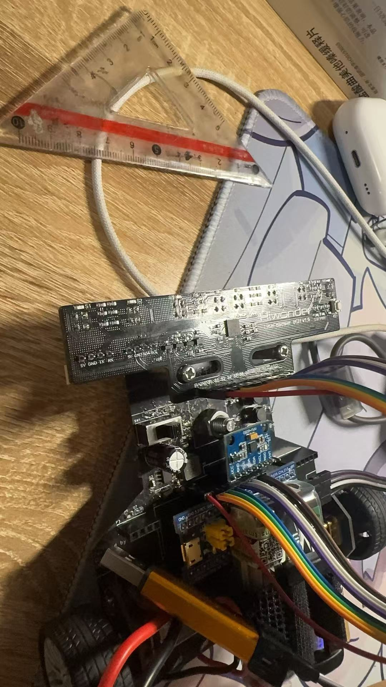

# stm32 八路光电管寻路

基于 STM32F103C8 和八路光电传感器的智能车循迹项目。项目按 **代码、机械、PCB** 三部分整理，分别维护固件、支架模型和电路设计。

## 三部分导航

| 部分 | 内容 | 主要文件 | 打开方式 |
| --- | --- | --- | --- |
| [代码](代码/) | STM32 源码、驱动和 Keil 工程 | [Project.uvprojx](代码/Project.uvprojx) | Keil MDK / µVision |
| [机械](机械/) | 支架零件模型、实物装配照片 | [支架.SLDPRT](机械/支架.SLDPRT) | SolidWorks |
| [PCB](PCB/) | 原理图与 PCB 设计工程 | [stm32 8路光电管寻路.eprj2](PCB/stm32%208路光电管寻路.eprj2) | 立创 EDA 专业版 |

## 目录结构

```text
stm32-8-channel-line-following/
├── 代码/
│   ├── README.md
│   ├── Project.uvprojx       # Keil 工程入口
│   ├── Project.uvoptx        # Keil 工程选项
│   ├── User/                # 主程序、中断和外设配置
│   ├── Hardware/            # 循迹、电机、MPU6050、OLED 等驱动
│   ├── Library/             # STM32F10x 标准外设库
│   ├── Start/               # 启动文件和 CMSIS
│   └── System/              # 延时等系统模块
├── 机械/
│   ├── README.md
│   ├── 支架.SLDPRT
│   └── 实物照片.jpg
├── PCB/
│   ├── README.md
│   └── stm32 8路光电管寻路.eprj2
├── .gitignore
└── README.md
```

## 使用说明

- **编译固件**：打开 [代码/Project.uvprojx](代码/Project.uvprojx)，选择 `Target 1`，确认 STM32F103C8 的设备支持包和下载器设置后编译、烧录。详细说明见 [代码说明](代码/README.md)。
- **查看机械结构**：使用 SolidWorks 打开 [支架模型](机械/支架.SLDPRT)。说明和照片见 [机械说明](机械/README.md)。
- **查看电路设计**：使用立创 EDA 专业版打开 [原理图/PCB 工程](PCB/stm32%208路光电管寻路.eprj2)。详细说明见 [PCB 说明](PCB/README.md)。

## 实物参考


